<picture>
  <source media="(prefers-color-scheme: dark)" srcset="./assets/header-dark.svg"/>
  
</picture>
<!-- 01 · Tech Stack -->
<picture>
  <source media="(prefers-color-scheme: dark)" srcset="./assets/sec-stack-dark.svg"/>
  
</picture>
<picture>
  <source media="(prefers-color-scheme: dark)" srcset="https://skillicons.dev/icons?i=js%2Cts%2Creact%2Cnodejs%2Ctailwind%2Cpy%2Ctensorflow%2Cmysql%2Cmongodb%2Cgcp%2Cfigma%2Cgit&theme=dark"/>
  
</picture>
<!-- 02 · Find Me -->
<picture>
  <source media="(prefers-color-scheme: dark)" srcset="./assets/sec-connect-dark.svg"/>
  
</picture>
<a href="https://www.linkedin.com/in/m-dzaka-al-fikri-7bba421a4/"><picture><source media="(prefers-color-scheme: dark)" srcset="https://skillicons.dev/icons?i=linkedin&theme=dark"/></picture></a>
<a href="https://discordapp.com/users/665819147334057997"><picture><source media="(prefers-color-scheme: dark)" srcset="https://skillicons.dev/icons?i=discord&theme=dark"/></picture></a>
<a href="https://instagram.com/moredzl"><picture><source media="(prefers-color-scheme: dark)" srcset="https://skillicons.dev/icons?i=instagram&theme=dark"/></picture></a>
<a href="mailto:dzakaal10@gmail.com"><picture><source media="(prefers-color-scheme: dark)" srcset="https://skillicons.dev/icons?i=gmail&theme=dark"/></picture></a>
<!-- 03 · Activity -->
<picture>
  <source media="(prefers-color-scheme: dark)" srcset="./assets/sec-activity-dark.svg"/>
  
</picture>
<picture>
  <source media="(prefers-color-scheme: dark)" srcset="https://streak-stats.demolab.com?user=DzakaAl&hide_border=true&background=0D1117&ring=FF5A1F&fire=FF5A1F&currStreakNum=E6E1D8&sideNums=E6E1D8&currStreakLabel=FF5A1F&sideLabels=8A8580&dates=6E6A64&stroke=21262D"/>
  
</picture>
<picture>
  <source media="(prefers-color-scheme: dark)" srcset="https://raw.githubusercontent.com/DzakaAl/DzakaAl/output/pacman-contribution-graph-dark.svg"/>
  
</picture>
<!-- 04 · On Repeat -->
<picture>
  <source media="(prefers-color-scheme: dark)" srcset="./assets/sec-music-dark.svg"/>
  
</picture>
<a href="https://spotify-github-profile.kittinanx.com/api/view?uid=1fmexiar2ef0atinjn77zl4l0&redirect=true">
<picture>
  <source media="(prefers-color-scheme: dark)" srcset="https://spotify-github-profile.kittinanx.com/api/view?uid=1fmexiar2ef0atinjn77zl4l0&cover_image=true&theme=spotify-embed&show_offline=true&interchange=true&profanity=false&hide_remaster=true&border_radius=12&mode=dark&background_color=0d1117&bar_color=ff5a1f&bar_color_cover=false"/>
  
</picture>
</a>
<picture>
  <source media="(prefers-color-scheme: dark)" srcset="./assets/footer-dark.svg"/>
  
</picture>

