<h1 align="center">Hey 👋 What's Up?</h1>

  

###

  

###

  
  
  
  

###

<!-- GitHub Stats -->

  
  

###

<!-- GitHub Trophy -->

  

###

<!-- Spotify Now Playing -->

  

###

<!-- Pacman Contribution Graph -->
<picture>
  <source
    media="(prefers-color-scheme: dark)"
    srcset="https://raw.githubusercontent.com/DzakaAl/DzakaAl/output/pacman-contribution-graph-dark.svg"
  />
  <source
    media="(prefers-color-scheme: light)"
    srcset="https://raw.githubusercontent.com/DzakaAl/DzakaAl/output/pacman-contribution-graph.svg"
  />
  
</picture>

###

<!-- Profile Views -->

  

